---

<h3 align="left">✦ Skills</h3>

         

✦ GitHub Analytics Center

 

 

# ✦ Connect

---

- 🌱 I’m currently learning **Web Pentesting and Ethical Hacking**

- ✅ Connect with me **abdofaruok090@gmail.com** 

